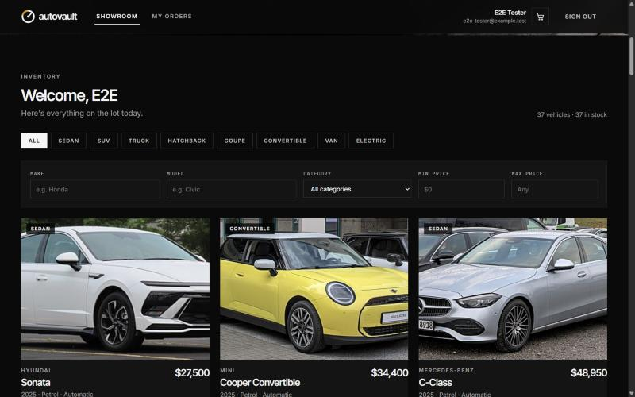
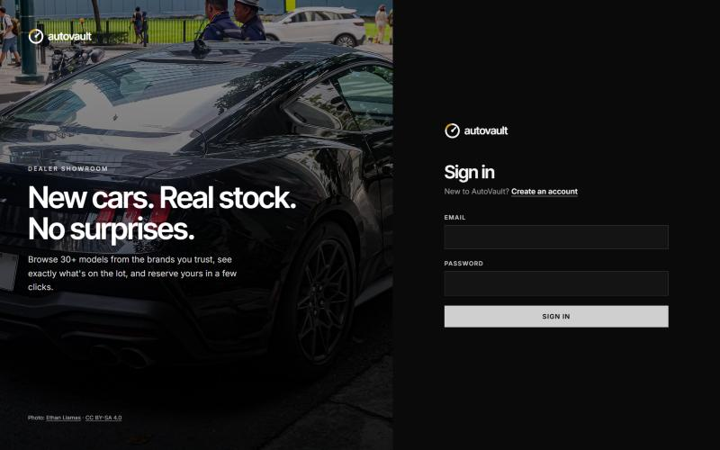
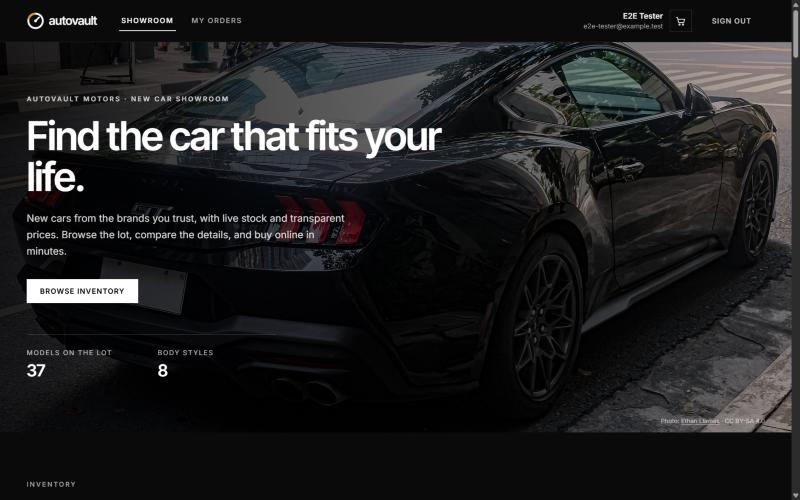
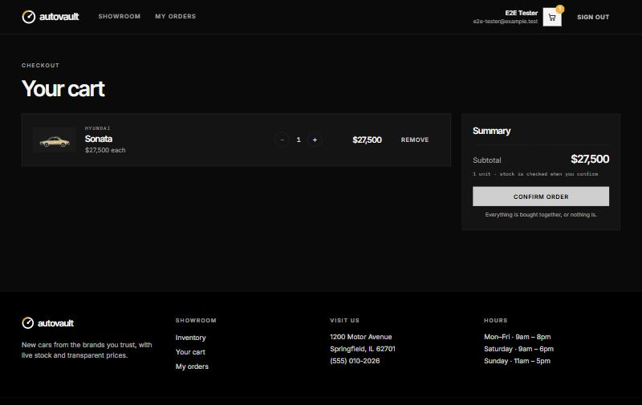
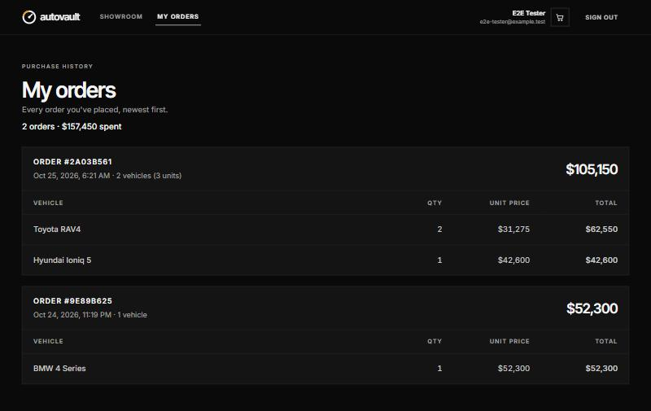
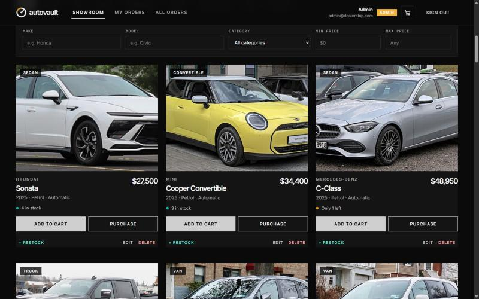
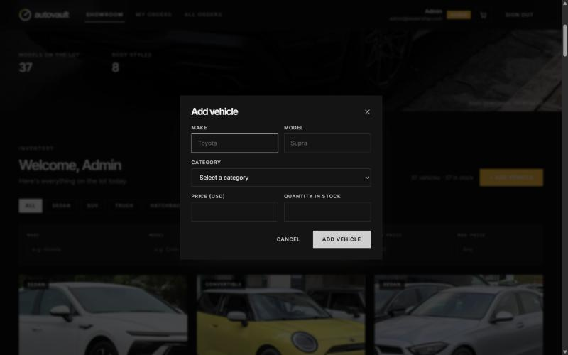
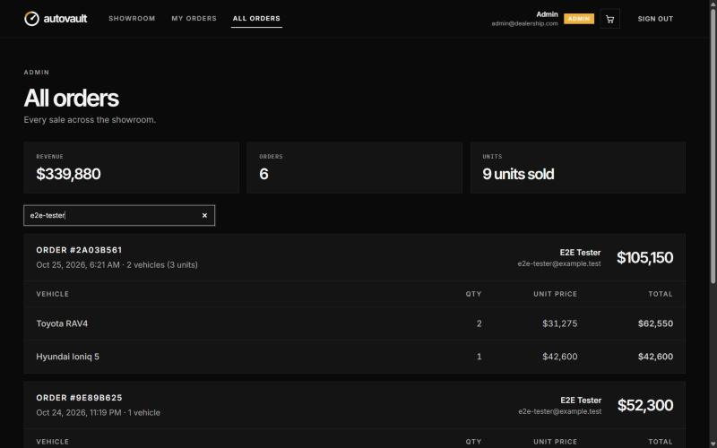
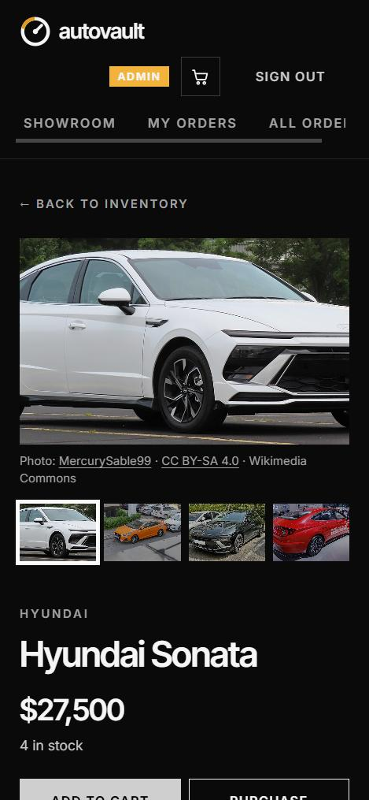

# AutoVault: Car Dealership Inventory System

**🔗 Live demo: https://autovault-dealership.vercel.app**

A full-stack inventory system for a car dealership: customers browse a showroom of 37 cars with photos and details, search and filter, and buy one car directly or several through a cart; admins add, edit, restock and archive vehicles and see every sale. Built test-first with an Express + TypeScript + PostgreSQL API and a React + Tailwind single-page app.



**Tests:** 232 backend + 87 frontend, all passing · **Coverage:** backend 98.6% statements, frontend 95.9% statements · [Full test report](docs/TEST_REPORT.md)

---

## Contents

- [Features](#features)
- [Tech stack](#tech-stack)
- [Architecture](#architecture)
- [Key design decisions](#key-design-decisions)
- [API reference](#api-reference)
- [Getting started](#getting-started)
- [Running the tests](#running-the-tests)
- [Screenshots](#screenshots)
- [How it was built](#how-it-was-built)
- [Known limitations](#known-limitations)
- [My AI Usage](#my-ai-usage)

## Features

**Everyone (signed in)**
- Register and sign in through one form; the account's role decides what you can do. The session survives a reload and signs out automatically when it expires.
- Home page with a headline, showroom stats and category shortcuts, then the showroom of all 37 sample vehicles with photo, category, price and live stock ("3 in stock", "Only 1 left", "Out of stock").
- **Vehicle page** per car: photo gallery (freely licensed Wikimedia Commons photos, each credited with author and license), year, body, fuel, transmission, seats and a short description.
- Search by make and model (partial, case-insensitive), filter by category and price range; results update as you type.
- **Cart**: add cars from the showroom (never more than are in stock), adjust quantities, then **confirm the order**. Checkout is all or nothing: if any car sold out meanwhile, nothing is bought and the message names the car.
- **Purchase** button on every car to buy it straight away, disabled when it is out of stock.
- **My orders**: each order with its number, date, vehicles, quantities and total.

**Admins**
- Add, edit, restock and delete vehicles from the showroom.
- Delete archives the vehicle: it disappears from the showroom but past orders keep their details.
- **All orders**: every order with the customer, plus revenue and units sold, searchable by customer or vehicle.

**Reliability and security**
- Two customers can never buy the same last car: stock is checked and decremented in one atomic database update, backed by a database `CHECK (quantity >= 0)`. Cart checkouts lock cars in a fixed order, so competing carts can't deadlock.
- Roles are read from the database on every request, so removing someone's admin rights takes effect immediately.
- Failed logins and registrations are rate-limited per client. Unknown emails cost the same bcrypt check as wrong passwords, so response times don't reveal which emails are registered.
- Tokens are signed and verified with HS256 only; tokens using any other algorithm (including `none`) are rejected.
- Security headers on every API response (Helmet: a locked-down CSP, HSTS, `nosniff`, `X-Frame-Options: DENY`, no referrer). Oversized request bodies (over 100 kB) get a 413.
- The server refuses to start with a missing, short or placeholder `JWT_SECRET`. In development it listens on localhost only; with `NODE_ENV=production` it listens on all interfaces so a hosting platform can reach it (`HOST` overrides either).

## Tech stack

| Layer | Technology |
|---|---|
| API | Node.js 24, Express 5, TypeScript (strict) |
| Database | PostgreSQL 16 via Prisma 7 (`@prisma/adapter-pg`), Docker Compose for local dev |
| Auth | JWT (`jsonwebtoken`, HS256), passwords hashed with `bcryptjs`, `helmet` security headers |
| Validation | zod |
| Frontend | React 19, Vite, Tailwind CSS v4, React Router |
| Backend tests | Jest + ts-jest, Supertest, a real Postgres test database |
| Frontend tests | Vitest, Testing Library, MSW (mock API) |
| CI | GitHub Actions (backend tests against Postgres) |

## Architecture

```
backend/src
├── routes/        URL → middleware chain → controller        (HTTP wiring only)
├── middleware/    authenticate · requireAdmin · validate · rateLimit · errorHandler
├── controllers/   thin: read the request, call a service, send the response
├── services/      business rules: AuthService, VehicleService, InventoryService
├── repositories/  interfaces (ports) + Prisma implementations
├── domain/        types and error classes (no framework code)
├── config.ts      environment validation
└── app.ts         composition root: wires repositories → services → controllers → routes
```

- **Services depend on repository interfaces, not on Prisma.** Unit tests swap in in-memory fakes; integration tests use the real Prisma repositories against Postgres.
- **Authentication and authorization are separate middleware.** `authenticate` answers "who is this?" (401 if unknown), `requireAdmin` answers "are they allowed?" (403 if not).
- **Errors are typed.** Services throw `NotFoundError`, `ConflictError` and so on; one error handler turns them into `{ "error": "..." }` with the right status.

```
frontend/src
├── api/          fetch client (ApiError), per-resource calls, useApi (adds token, signs out on 401)
├── auth/         AuthProvider (session in localStorage, refreshed from /api/auth/me), route guards
├── cart/         CartProvider (cart in localStorage per account)
├── pages/        Login, Register, Dashboard (home + showroom), Vehicle detail, Cart, My orders, All orders
├── components/   VehicleCard, VehiclePhoto (credited photos), OrderCard, header/footer, dialogs, admin forms
└── test/         MSW server, render helpers
```

## Key design decisions

| Decision | Why |
|---|---|
| **Atomic purchase**: one `UPDATE … WHERE quantity >= n` inside a transaction, then insert the order | Postgres locks the row, so a second buyer re-checks against the new stock and gets a 409. Proven with tests that fire up to 30 concurrent purchases. |
| **All-or-nothing checkout** with locks taken in vehicle-id order | A cart is one transaction; any short line rolls back the rest. Sorting the lines means every checkout locks rows in the same order, so carts sharing cars can't deadlock (a test fails 2/2 runs without the sort). |
| **Cart kept in the browser**, per account | No cart tables or endpoints; nothing is reserved, so the server re-checks everything at checkout. Trade-off: the cart doesn't follow you to another device. |
| **Orders group purchase lines** | A checkout is one order with several lines; a single Purchase is a one-line order. Existing purchases were migrated into one-line orders. |
| **Soft delete** (`isArchived`) | Purchases reference vehicles; archiving keeps order history intact. Purchases also store make, model and unit price at the time of sale. |
| **Admins created by a seed script**, never via the API | No way to self-register as admin. `npm run seed` creates the admin from `ADMIN_EMAIL` / `ADMIN_PASSWORD`. |
| **Only admins change the catalogue** | Matches the spec's admin UI. Regular users can browse and buy. |
| **Stock changes only through purchase and restock** | `PUT /api/vehicles/:id` rejects `quantity`, so stock and order history can't drift apart. |
| **Role read from the database per request** | Tokens can't keep powers that were revoked. Costs one primary-key lookup per request. |
| **Token in `localStorage`** | Simple and survives reloads. Trade-off: readable by injected scripts (an httpOnly cookie would not be); mitigated by a 1-hour token and per-request account checks. |
| **All vehicles listed, including out-of-stock** | The spec asks for a disabled Purchase button at zero stock, so those cars must be shown. |

## API reference

All responses are JSON. Errors look like `{ "error": "message" }`: 400 invalid input or malformed JSON, 401 not signed in, 403 not allowed, 404 not found, 409 conflict (e.g. not enough stock), 413 body too large, 429 rate-limited.

| Method | Path | Access | Notes |
|---|---|---|---|
| POST | `/api/auth/register` | public | `{ name, email, password }` → 201 `{ user }`. Rate-limited. |
| POST | `/api/auth/login` | public | `{ email, password }` → `{ token, user }`. Failed attempts rate-limited. |
| GET | `/api/auth/me` | signed in | Current account (role as it is now). |
| GET | `/api/vehicles` | signed in | All non-archived vehicles. |
| GET | `/api/vehicles/search` | signed in | Query: `make`, `model`, `category`, `minPrice`, `maxPrice` (all optional). |
| GET | `/api/vehicles/:id` | signed in | One vehicle with its details and photos. |
| POST | `/api/vehicles` | admin | `{ make, model, category, price, quantity }` plus optional `year, fuelType, transmission, seats, description` → 201. |
| PUT | `/api/vehicles/:id` | admin | Any of `make, model, category, price` and the optional details (not quantity). |
| DELETE | `/api/vehicles/:id` | admin | Archives the vehicle → 204. |
| POST | `/api/vehicles/:id/purchase` | signed in | Optional `{ quantity }` (default 1) → 201 `{ purchase, vehicle }`; 409 if not enough stock. Recorded as a one-line order. |
| POST | `/api/orders` | signed in | `{ items: [{ vehicleId, quantity }] }` (1–20 lines) → 201 `{ order, vehicles }`. All or nothing; 409 names the short vehicle, 404 if one no longer exists. |
| GET | `/api/orders/me` | signed in | The caller's orders with their lines, newest first. |
| GET | `/api/orders` | admin | All orders with the customer's name and email. |
| POST | `/api/vehicles/:id/restock` | admin | `{ amount }` (1–1000) → updated vehicle. |
| GET | `/api/purchases/me` | signed in | The caller's purchase lines, ungrouped (kept for compatibility). |
| GET | `/api/purchases` | admin | All purchase lines with the customer (kept for compatibility). |
| GET | `/api/health` | public | `{ status: "ok" }` |

Categories: `SEDAN`, `SUV`, `TRUCK`, `HATCHBACK`, `COUPE`, `CONVERTIBLE`, `VAN`, `EV`.

## Getting started

### Prerequisites

- Node.js 20+ (developed on 24) and npm
- Docker Desktop (for PostgreSQL)

### 1. Start PostgreSQL

From the repository root:

```bash
docker compose up -d
```

This starts Postgres 16 on **localhost:5433** (5433 avoids clashing with a locally installed Postgres) and creates two databases: `dealership` for development and `dealership_test` for the tests.

### 2. Backend

```bash
cd backend
npm install
cp .env.example .env
```

Edit `backend/.env`:
- `JWT_SECRET`: at least 32 random characters. Generate one with `node -e "console.log(require('crypto').randomBytes(48).toString('base64url'))"`.
- `ADMIN_PASSWORD`: the password for the seeded admin account, at least 12 characters.

The server deliberately refuses to start if these are missing or still placeholders.

```bash
npx prisma generate          # generate the database client
npx prisma migrate deploy    # create the tables
npm run seed                 # admin account + 37 sample vehicles with photos (safe to re-run)
npm run dev                  # API on http://127.0.0.1:4000
```

### 3. Frontend

In a second terminal:

```bash
cd frontend
npm install
npm run dev                  # app on http://localhost:5173
```

The dev server forwards `/api` to the backend on port 4000, so no CORS setup is needed locally. Sign in with the admin account from your `.env`, or register a new (regular) account.

For a deployed build, set `VITE_API_URL` to the API's address before `npm run build`, and add the frontend's address to the backend's `CORS_ORIGINS`. Run the API with `NODE_ENV=production` (listens on all interfaces) and `TRUST_PROXY=1` behind a hosting proxy.

The sample photos are already in `backend/prisma/vehicle-photos.json`. To re-fetch them from Wikimedia Commons, give your own contact, which Wikimedia's API policy asks for: `WIKIMEDIA_CONTACT=you@example.com node scripts/fetch-vehicle-photos.mjs`.

## Running the tests

Docker must be running for the backend integration tests.

```bash
cd backend && npm test               # or npm run test:coverage
cd frontend && npm test              # or npm run test:coverage
```

| Suite | Tests | Statements | Branches | Functions | Lines |
|---|---|---|---|---|---|
| Backend (Jest) | 232 / 232 | 98.61% | 93.41% | 100% | 98.91% |
| Frontend (Vitest) | 87 / 87 | 95.87% | 90.81% | 95.67% | 97.2% |

The [full test report](docs/TEST_REPORT.md) lists every test and per-file coverage.

What the tests cover:
- **Backend unit tests**: services with in-memory fake repositories (business rules, validation, error cases).
- **Backend integration tests**: every endpoint through HTTP against a real Postgres test database: status codes, 401 vs 403, validation, archiving, rate limits, security headers, 413 for oversized bodies, startup config. Error tests check the specific error (e.g. the violated database constraint), not just that something failed.
- **Security tests**: tokens with the wrong algorithm or `alg: none` are rejected; a login for an unknown email still runs a full bcrypt comparison.
- **Concurrency tests**: purchases fired in parallel straight at the repository (1 car / 5 buyers, 3 / 10, 5 / 30, mixed quantities, purchases racing restocks); carts racing for the last unit, and carts locking the same cars in opposite orders (no deadlocks). Deliberately broken versions were run against them: removing the stock check fails 10 tests, removing the lock ordering fails the deadlock test.
- **Frontend tests**: whole pages rendered with Testing Library and a mock API: forms, validation, loading, error and empty states, vehicle detail and photo credits, purchase and cart flows, checkout, admin dialogs, route guards, session refresh.

## Screenshots

| | |
|---|---|
|  Sign in |  Home page |
|  Showroom and filters |  Vehicle page with credited photos |
|  Cart |  My orders |
|  Admin view with Restock / Edit / Delete |  Add vehicle |
|  All orders (admin) |  Phone layout |

## How it was built

- **Test-driven:** features were built as red → green (→ refactor) commit pairs: 27 failing-test commits, each followed by the commit that makes it pass, plus refactor commits. The git history reads as the development story.
- **Reviewed for production readiness** midway through, which led to several fixes: genuinely concurrent overselling tests, rejecting placeholder secrets, per-request role checks, rate limiting, graceful shutdown and binding the dev database to localhost.
- **Pre-release audit** at the end, which added security headers, 413 handling, HS256 pinning, equal-cost logins, a localhost-only dev server and stricter test assertions, each test-first.
- **Checked in the browser** against the real backend after each frontend feature. This caught a price-formatting bug ("$18,500.5") that the tests had missed, which was then fixed test-first.

## Known limitations

- Rate-limit counters live in memory: exact for one server, per-instance if the API is scaled out (a shared store such as Redis would fix that).
- A role change appears in the UI on the next reload; the API enforces it immediately either way.
- The JWT is stored in `localStorage` (see design decisions); signing out clears it in the browser but the token stays valid until it expires (at most 1 hour).
- The admin Add/Edit form covers make, model, category, price and stock; the newer details (year, fuel, transmission, seats, description) can be set through the API and the seed but not yet in the form.
- Checkout has no idempotency key: the UI disables the button while an order is placed, but a client that blindly retried a request could place it twice.
- Lists aren't paginated (fine for a showroom of this size).
- CI runs the backend suite only; the frontend suite runs locally.
- This is a demo: there is no privacy notice, terms of sale or refund policy, which a real store would need.
- Deployed on Vercel (frontend + API as a serverless function) with a Neon Postgres database; rate-limit counters are per function instance there.

## My AI Usage

### Tools

- **Claude Code** (Anthropic's coding agent, model Claude Opus 5.5), used in the Claude desktop app with access to the project folder, a terminal and a built-in browser.

Every commit where AI helped carries the trailer `Co-authored-by: Claude <noreply@anthropic.com>`, which is every commit in this repository. The raw, unedited conversation is in [PROMPTS.md](PROMPTS.md).

### How I used it

- **Planning:** I gave Claude the assignment PDF and asked for a requirements summary, an architecture and a list of decisions I needed to make. I then made those decisions myself, step by step: Express + TypeScript, PostgreSQL (because I wanted to deploy), admins created by a seed script, adding order history, and archiving instead of hard deletes.
- **Implementation with TDD:** for each feature I asked Claude to write the failing tests first, commit them, then implement until green. Claude wrote most of the code; I reviewed each step's summary and steered scope, e.g. asking for authentication and role checks to stay separate with specific 401/403 behaviour.
- **Understanding the code:** I asked Claude to walk me through how a search request travels from the Express route to Prisma and Postgres, and what happens when two customers buy the last car at the same time.
- **Review:** I asked for a production-readiness review without code changes, ranked by severity. Its main finding was that the overselling tests could not actually detect overselling, which Claude proved by running a deliberately broken implementation against them. I then chose which findings to fix.
- **Debugging and environment issues:** Claude diagnosed a local PostgreSQL service occupying port 5432, Prisma 7's new configuration, MSW 3's renamed options and a Docker Desktop update stopping the database.
- **Verification and docs:** Claude ran the app in a browser against the real backend after each frontend feature, took the screenshots and drafted this README and the test report.

### Reflection

> ✍️ **Draft: rewrite this in your own words before submitting.**

AI made the project much faster: scaffolding, test suites and UI that would have taken days took hours. What mattered most was not code generation but keeping the AI honest. Asking for a review that challenged the work found that a passing concurrency test proved nothing, and checking features in a real browser found a bug that every test had missed. Making the important decisions myself and asking "why" at each step meant I understood the design rather than just receiving it. The main risk I saw is trusting green tests without asking what they actually prove.
