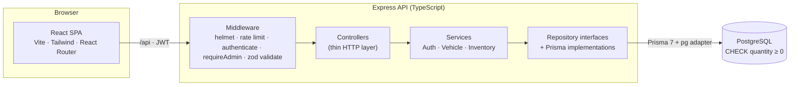

# AutoVault: Car Dealership Inventory System

[](https://github.com/turbzox1/car-dealership-inventory/actions/workflows/backend-ci.yml)


**🔗 Live demo: https://autovault-dealership.vercel.app** · register any account to browse and buy

A full-stack dealership app built test-first: customers browse 37 cars with photos, search and filter, and buy one car or a whole cart; admins manage stock and see every sale. Express + TypeScript + PostgreSQL API, React + Tailwind single-page app, deployed on Vercel with Neon Postgres.


## Highlights

| | |
|---|---|
| ✅ **320 tests, all passing** | 232 backend (Jest, real Postgres) + 88 frontend (Vitest) · coverage 98.6% / 95.9% statements · [full report](docs/TEST_REPORT.md) |
| 🔒 **No overselling, proven** | Stock is checked and decremented in one atomic `UPDATE … WHERE quantity >= n`. Concurrency tests fire up to 30 parallel buyers at the database; with the stock check removed, 10 of them fail |
| 🛒 **Deadlock-free cart checkout** | All-or-nothing transaction that locks rows in vehicle-id order; the deadlock test fails without the sort |
| 🧪 **TDD history** | 29 red → green commit pairs plus refactors; the log reads as the build story |
| 🛡️ **Security, test-covered** | Roles read from the DB on every request, HS256-only JWTs, equal-cost logins, rate limiting, Helmet headers, startup rejects weak secrets |
| 🧱 **Layered architecture** | Services depend on repository interfaces: unit tests use in-memory fakes, integration tests hit Postgres |

## Architecture



- **Composition root** (`backend/src/app.ts`) wires repositories → services → controllers → routes; the same app runs as a Node server locally and as a Vercel function in production.
- **Authentication and authorization are separate**: `authenticate` returns 401 for unknown callers, `requireAdmin` returns 403 for signed-in non-admins.
- **Typed errors**: services throw `NotFoundError`, `ConflictError` and similar; one error handler maps them to `{ "error": "..." }` with the right status.

<details>
<summary>Folder layout</summary>

```
backend/src
├── routes/        URL → middleware chain → controller
├── middleware/    authenticate · requireAdmin · validate · rateLimit · errorHandler
├── controllers/   read the request, call a service, send the response
├── services/      business rules: AuthService, VehicleService, InventoryService
├── repositories/  interfaces (ports) + Prisma implementations
├── domain/        types and error classes (no framework code)
├── config.ts      environment validation
└── app.ts         composition root

frontend/src
├── api/           fetch client, per-resource calls, useApi (adds token, signs out on 401)
├── auth/          AuthProvider (session refreshed from /api/auth/me), route guards
├── cart/          CartProvider (cart in localStorage per account)
├── pages/         Login, Register, Dashboard, Vehicle detail, Cart, My orders, All orders
└── components/    vehicle cards, credited photos, order cards, dialogs, admin forms
```
</details>

## Features

- **Customers:** one sign-in form for everyone; showroom with live stock ("Only 1 left"), search by make/model, filter by category and price; vehicle pages with credited Wikimedia Commons photos and specs; a **Purchase** button disabled at zero stock; a cart with all-or-nothing checkout; order history.
- **Admins:** add, edit, restock and delete (archive) vehicles; an all-orders view with revenue, units sold and search. Archiving keeps past orders intact.
- **Admin accounts** come only from the seed script, never from the API, so nobody can self-register as admin.

## Key engineering decisions

| Decision | Why |
|---|---|
| Atomic conditional update + `CHECK (quantity >= 0)` | The row lock makes a second buyer re-check against the new stock and get a 409; the constraint is a last line of defence |
| Locks taken in a fixed order at checkout | Carts sharing cars always lock in the same order, so they can't deadlock |
| Role loaded from the database per request | Revoked admin rights take effect immediately, not when the token expires |
| Soft delete (`isArchived`) + price snapshot on each sale | Order history stays correct after a car is removed or repriced |
| Stock changes only via purchase and restock | `PUT /api/vehicles/:id` rejects `quantity`, so stock and order history can't drift |
| Cart kept in the browser | No cart tables; the server re-checks everything at checkout. Trade-off: the cart doesn't follow you across devices |
| JWT in `localStorage` | Simple and survives reloads; mitigated by a 1-hour token, per-request account checks and a strict API CSP |

## Run it locally

**Needs:** Node.js 20+ (developed on 24), npm, Docker Desktop.

```bash
# 1. Postgres 16 on localhost:5433 (dev + test databases)
docker compose up -d

# 2. API
cd backend
npm install
cp .env.example .env         # then set JWT_SECRET (32+ chars) and ADMIN_PASSWORD (12+ chars)
npx prisma generate
npx prisma migrate deploy
npm run seed                 # admin account + 37 sample cars (safe to re-run)
npm run dev                  # http://127.0.0.1:4000

# 3. Frontend (second terminal)
cd frontend
npm install
npm run dev                  # http://localhost:5173 (proxies /api to the API)
```

Generate a `JWT_SECRET` with `node -e "console.log(require('crypto').randomBytes(48).toString('base64url'))"`. The API refuses to start with a missing, short or placeholder secret. Sign in with the seeded admin from your `.env`, or register a regular account.

**Tests** (Docker must be running for the backend suite):

```bash
cd backend && npm test        # or npm run test:coverage
cd frontend && npm test       # or npm run test:coverage
```

<details>
<summary>Deployment (Vercel + Neon)</summary>

`vercel.json` builds the frontend and serves the Express app as a function at `/api` on the same domain (`api/index.ts` → `backend/src/vercel.ts`). On production builds, `scripts/vercel-build.sh` runs `prisma migrate deploy` and the idempotent seed over Neon's direct connection. Required environment variables: `DATABASE_URL` (added by the Neon integration), `JWT_SECRET`, `ADMIN_EMAIL`, `ADMIN_PASSWORD`, `NODE_ENV=production`, `TRUST_PROXY=1`.

The sample photos are already in `backend/prisma/vehicle-photos.json`; to re-fetch them run `WIKIMEDIA_CONTACT=you@example.com node scripts/fetch-vehicle-photos.mjs` from `backend/` (Wikimedia's API policy asks for a contact).
</details>

## Test results

Verified by running both suites with coverage:

| Suite | Tests | Statements | Branches | Functions | Lines |
|---|---|---|---|---|---|
| Backend (Jest + Supertest, real Postgres) | 232 / 232 | 98.61% | 93.41% | 100% | 98.91% |
| Frontend (Vitest + Testing Library + MSW) | 88 / 88 | 95.87% | 90.81% | 95.67% | 97.2% |

- **Concurrency:** parallel purchases at the repository (1 car / 5 buyers, 3 / 10, 5 / 30, purchases racing restocks) and carts racing for the last unit or locking in opposite orders. Run against deliberately broken code, they fail as they should.
- **Integration:** every endpoint over HTTP against Postgres: 401 vs 403, validation, archiving, rate limits, security headers, 413 for oversized bodies, startup config. Error tests assert the specific error, such as the violated constraint.
- **Frontend:** whole pages with a mock API: forms, loading/error/empty states, purchase and cart flows, admin dialogs, route guards, session refresh.
- **CI:** GitHub Actions runs the backend type-check, dependency audit and full suite against Postgres on every backend change. The frontend suite runs locally.

## API

Errors are `{ "error": "message" }`: 400 invalid input, 401 not signed in, 403 not allowed, 404 not found, 409 conflict (e.g. not enough stock), 413 body too large, 429 rate-limited.

<details>
<summary>All endpoints</summary>

| Method | Path | Access | Notes |
|---|---|---|---|
| POST | `/api/auth/register` | public | `{ name, email, password }` → 201. Rate-limited |
| POST | `/api/auth/login` | public | `{ email, password }` → `{ token, user }`. Failed attempts rate-limited |
| GET | `/api/auth/me` | signed in | Current account, role as it is now |
| GET | `/api/vehicles` | signed in | All non-archived vehicles |
| GET | `/api/vehicles/search` | signed in | `make`, `model`, `category`, `minPrice`, `maxPrice` (all optional) |
| GET | `/api/vehicles/:id` | signed in | One vehicle with details and photos |
| POST | `/api/vehicles` | admin | `{ make, model, category, price, quantity }` + optional details → 201 |
| PUT | `/api/vehicles/:id` | admin | Any field except `quantity` |
| DELETE | `/api/vehicles/:id` | admin | Archives the vehicle → 204 |
| POST | `/api/vehicles/:id/purchase` | signed in | Optional `{ quantity }` → 201; 409 if not enough stock |
| POST | `/api/vehicles/:id/restock` | admin | `{ amount }` (1–1000) |
| POST | `/api/orders` | signed in | `{ items: [{ vehicleId, quantity }] }` (1–20 lines), all or nothing |
| GET | `/api/orders/me` | signed in | Caller's orders, newest first |
| GET | `/api/orders` | admin | All orders with customer |
| GET | `/api/purchases/me`, `/api/purchases` | signed in / admin | Ungrouped purchase lines (kept for compatibility) |
| GET | `/api/health` | public | `{ status: "ok" }` |

Categories: `SEDAN`, `SUV`, `TRUCK`, `HATCHBACK`, `COUPE`, `CONVERTIBLE`, `VAN`, `EV`.
</details>

## Screenshots

| | |
|---|---|
|  Home |  Vehicle page with credited photos |
|  Cart |  My orders |
|  Admin: restock, edit, delete |  Admin: all orders |

<details>
<summary>More: sign in, add vehicle, phone layout</summary>

| | | |
|---|---|---|
|  Sign in |  Add vehicle |  Phone layout |
</details>

## Known limitations

- Rate-limit counters are in memory, so on Vercel they are per function instance (a shared store such as Redis would fix this).
- Signing out clears the token in the browser, but it stays valid until it expires (at most 1 hour).
- The admin form doesn't yet edit the newer vehicle details (year, fuel, transmission, seats, description); the API and seed do.
- Checkout has no idempotency key; the UI prevents double submits, but a client retrying blindly could order twice.
- No pagination, and no privacy notice or terms of sale (it's a demo, not a real store).

## My AI Usage

### Tools

- **Claude Code** (Anthropic's coding agent, model Claude Opus 5.5), used in the Claude desktop app with access to the project folder, a terminal and a built-in browser.

Every commit where AI helped carries the trailer `Co-authored-by: Claude <noreply@anthropic.com>`, which is every commit in this repository. The raw, unedited conversation is in [PROMPTS.md](PROMPTS.md).

### How I used it

- **Planning:** I gave Claude the assignment PDF and asked for a requirements summary, an architecture and a list of decisions I needed to make. I then made those decisions myself, step by step: Express + TypeScript, PostgreSQL (because I wanted to deploy), admins created by a seed script, adding order history, and archiving instead of hard deletes.
- **Implementation with TDD:** for each feature I asked Claude to write the failing tests first, commit them, then implement until green. Claude wrote most of the code; I reviewed each step's summary and steered scope, e.g. asking for authentication and role checks to stay separate with specific 401/403 behaviour.
- **Understanding the code:** I asked Claude to walk me through how a search request travels from the Express route to Prisma and Postgres, and what happens when two customers buy the last car at the same time.
- **Review:** I asked for a production-readiness review without code changes, ranked by severity. Its main finding was that the overselling tests could not actually detect overselling, which Claude proved by running a deliberately broken implementation against them. I then chose which findings to fix.
- **Debugging and environment issues:** Claude diagnosed a local PostgreSQL service occupying port 5432, Prisma 7's new configuration, MSW 3's renamed options and a Docker Desktop update stopping the database.
- **Verification and docs:** Claude ran the app in a browser against the real backend after each frontend feature, took the screenshots and drafted this README and the test report.

### Reflection

Using AI made development faster, but I learned that getting code to work is only part of the job. I still needed to question decisions, understand the code, and check whether the tests actually proved anything. One important lesson was discovering that a passing test could miss a real concurrency bug. Testing the app in a browser also helped me catch issues automated tests missed. Overall, AI was a useful development partner, but reviewing, testing, and understanding what I built remained my responsibility.
